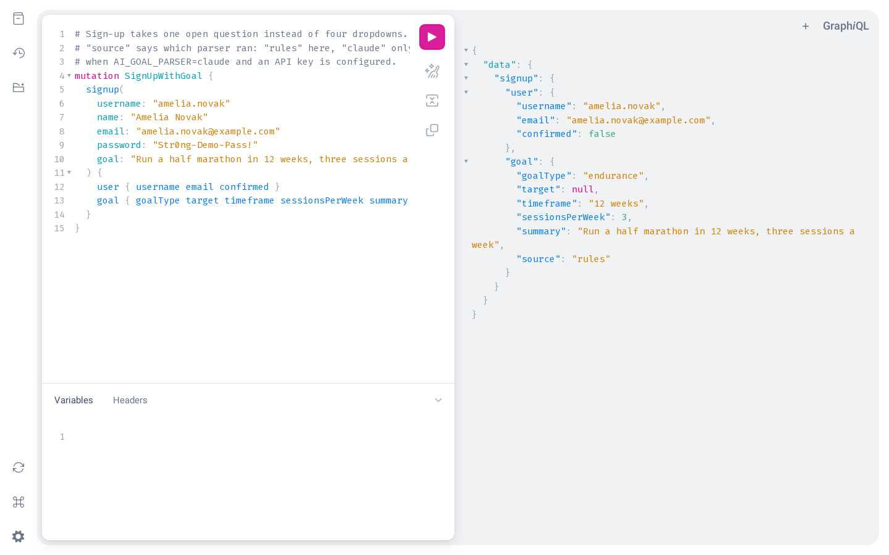
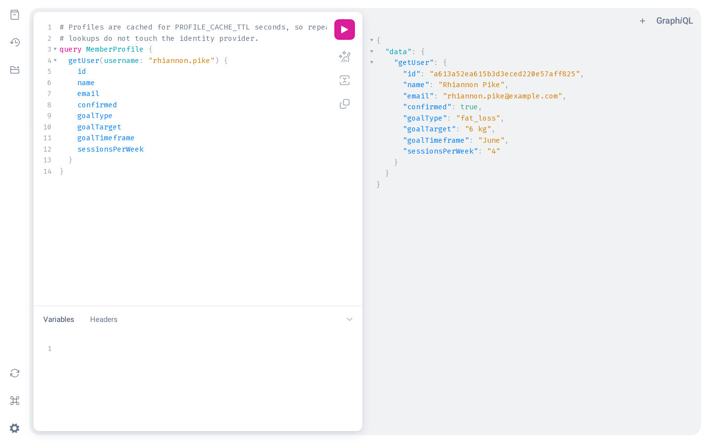
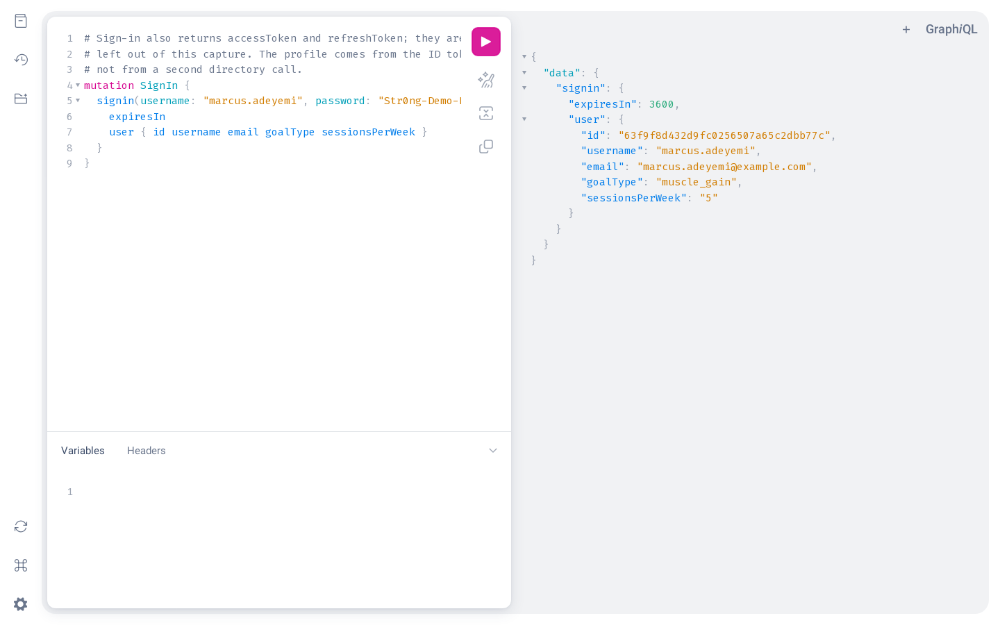
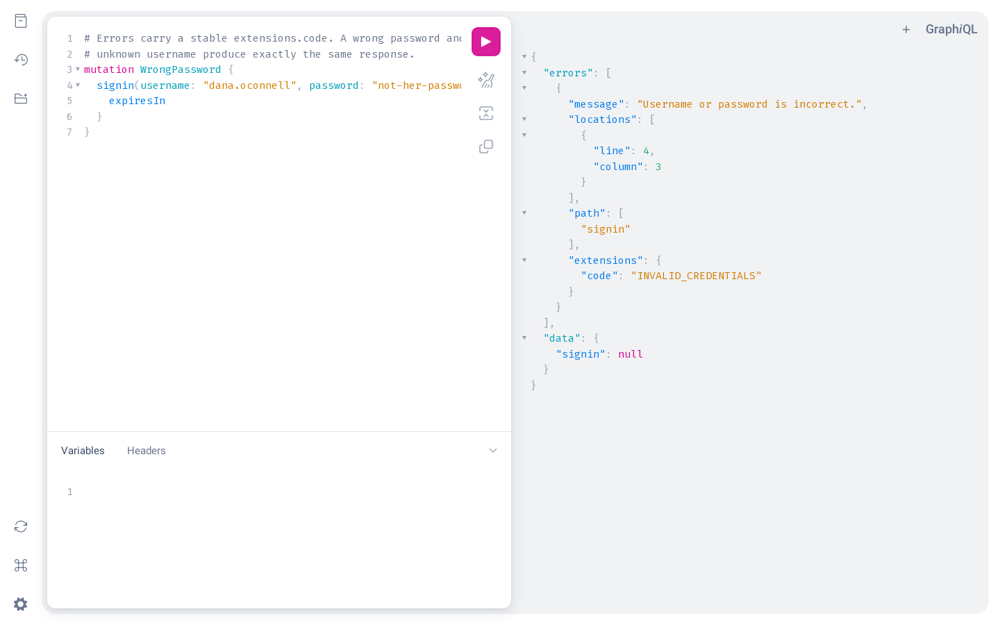
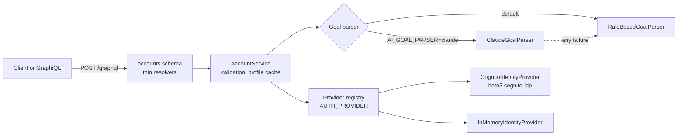

# AlterCall Fitness: identity service

A Django service that handles sign-up, email OTP confirmation and sign-in for the AlterCall coaching platform through one GraphQL endpoint. In production the accounts live in an AWS Cognito user pool. For local work there is an in-memory provider with the same behaviour, so you can run, test and demo the whole flow without an AWS account.

Sign-up also takes the member's fitness goal as free text ("Run a half marathon in 12 weeks, three sessions a week") and stores a structured version next to the account: goal type, target, timeframe and sessions per week. Coaches get something to plan against from the first session, and the member answers one question instead of filling in four dropdowns.



## Quick start

You need Docker with the Compose plugin.

```bash
docker compose up --build
```

The service listens on http://localhost:8550. Compose runs it with `AUTH_PROVIDER=memory` and seeds four demo members (`rhiannon.pike`, `marcus.adeyemi`, `yuki.tanaka`, `dana.oconnell`, all with the password `Str0ng-Demo-Pass!`). The in-memory provider always uses `123456` as the confirmation code.

Open http://localhost:8550/graphql for GraphiQL, or call it directly:

```bash
curl -s -X POST http://localhost:8550/graphql -H 'Content-Type: application/json' \
  -d '{"query": "{ getUser(username: \"rhiannon.pike\") { username confirmed goalType goalTarget goalTimeframe sessionsPerWeek } }"}'
```

```json
{
  "data": {
    "getUser": {
      "username": "rhiannon.pike",
      "confirmed": true,
      "goalType": "fat_loss",
      "goalTarget": "6 kg",
      "goalTimeframe": "June",
      "sessionsPerWeek": "4"
    }
  }
}
```

The in-memory directory lives inside the server process and is empty again after a restart.

## API

| Operation | Purpose |
| --- | --- |
| `mutation signup(username, name, password, email, goal)` | Create an unconfirmed account. `goal` is optional free text and comes back structured. |
| `mutation confirmUser(username, otp)` | Confirm the account with the emailed code. |
| `mutation signin(username, password)` | Return `accessToken`, `refreshToken`, `expiresIn` and the member's profile. |
| `query getUser(username)` | Fetch a profile (cached for `PROFILE_CACHE_TTL` seconds). |
| `query previewGoal(text)` | Structure a goal without creating anything, for a live preview on the sign-up form. |
| `query authProvider` | Name of the active identity provider. |
| `GET /healthz` | Readiness probe: 200 when the provider is configured, 503 otherwise. |

Failures come back as GraphQL errors with a stable code in `extensions.code`, so clients can branch without parsing messages:

| Code | When |
| --- | --- |
| `INVALID_INPUT` | A required field is blank, or Cognito rejected a field's format. |
| `USER_ALREADY_EXISTS` | The username is taken. |
| `WEAK_PASSWORD` | The password fails the pool's policy (8 characters minimum on the memory provider). |
| `INVALID_CONFIRMATION_CODE` | Wrong or expired OTP. |
| `USER_NOT_CONFIRMED` | Sign-in before confirmation. |
| `INVALID_CREDENTIALS` | Wrong password **or** unknown username. Both give the same response. |
| `SIGN_IN_CHALLENGE_REQUIRED` | Cognito asked for a new password or MFA, which this service does not handle. |
| `USER_NOT_FOUND` | `getUser` for a username that does not exist. |
| `TOO_MANY_REQUESTS` | Cognito throttled the request. |
| `PROVIDER_UNAVAILABLE` | Cognito is not configured or not reachable. |

```json
{
  "errors": [
    {
      "message": "Username or password is incorrect.",
      "locations": [
        {
          "line": 1,
          "column": 12
        }
      ],
      "path": [
        "signin"
      ],
      "extensions": {
        "code": "INVALID_CREDENTIALS"
      }
    }
  ],
  "data": {
    "signin": null
  }
}
```

[docs/api-examples.md](docs/api-examples.md) has the full set of requests and responses captured from the compose stack: sign-up with a goal, sign-in before and after confirmation, the identical wrong-password and unknown-user errors, and a blank field.

| | |
| --- | --- |
|  |  |
|  | |

## How it fits together



- **One seam for the identity backend.** Everything above `accounts/providers/base.py` talks to an `IdentityProvider`, never to boto3. Cognito and the in-memory directory both implement it and raise the same domain errors, so the GraphQL behaviour does not change with the backend. Adding another backend means one class and a `register()` call.
- **No account enumeration.** A wrong password and an unknown username map to the same `INVALID_CREDENTIALS` error. Cognito's `UserNotFoundException` on sign-in is translated before it reaches the client.
- **Provider errors stay inside the adapter.** Cognito exceptions are mapped to domain errors in `accounts/providers/cognito.py`. Anything unmapped becomes `PROVIDER_UNAVAILABLE` and is logged server-side, so AWS request ids and pool ids never reach a client.
- **One AWS call per sign-in.** `initiate_auth` already returns an ID token with `sub`, email, name and the custom goal attributes, so the profile is read from it instead of a follow-up `admin_get_user`. The profile then goes into the cache, so the `getUser` that usually follows costs nothing. [docs/benchmark_signin.py](docs/benchmark_signin.py) measures this against a local Cognito stub ([output](docs/benchmark-output.txt)).
- **AI is optional.** Goal parsing uses keyword and regex rules by default. With `AI_GOAL_PARSER=claude`, an `ANTHROPIC_API_KEY` and the `anthropic` package installed, Claude extracts the same JSON shape. A missing key, a failed call or a malformed reply falls back to the rules, and the `source` field says which parser produced the result.
- **Fails fast when misconfigured.** The boto3 client is built on first use, so a checkout without AWS settings still imports and serves introspection. `/healthz` returns 503 when Cognito is selected but its settings are missing.

## Configuration

Settings come from environment variables. For a local run outside Docker, copy `.env.sample` to `.env`; every value in it is a placeholder.

| Variable | Default | Notes |
| --- | --- | --- |
| `AUTH_PROVIDER` | `cognito` (`memory` in compose) | `cognito` or `memory`. |
| `COGNITO_REGION`, `COGNITO_USER_POOL_ID`, `COGNITO_CLIENT_ID` | unset | Required for Cognito. The app client needs `USER_PASSWORD_AUTH` enabled. |
| `AWS_ACCESS_KEY_ID`, `AWS_SECRET_ACCESS_KEY` | unset | Leave unset in production so boto3 uses the instance role. |
| `DJANGO_SECRET_KEY` | unset | Required unless `DJANGO_DEBUG=1`. |
| `DJANGO_DEBUG` | `0` | |
| `DJANGO_ALLOWED_HOSTS` | `localhost,127.0.0.1` | |
| `PROFILE_CACHE_TTL` | `60` | Seconds; `0` turns the profile cache off. |
| `GRAPHIQL_ENABLED` | on in debug | GraphiQL in the browser at `/graphql`. |
| `SEED_DEMO_ON_START` | `0` (`1` in compose) | Seeds the demo members; memory provider only. |
| `WEB_CONCURRENCY` | `3` in the image, `1` in compose | Gunicorn worker processes. Keep it at 1 with the memory provider, because each worker would have its own user store. |
| `CORS_ALLOWED_ORIGINS` / `CORS_ALLOW_ALL_ORIGINS` | empty / on in debug | |
| `AI_GOAL_PARSER`, `AI_MODEL`, `ANTHROPIC_API_KEY` | `rules`, `claude-opus-5`, unset | Optional model-based goal parsing. `anthropic` is not in `requirements.txt`; install it alongside if you turn this on. |

To run the compose stack against a real pool, put `AUTH_PROVIDER=cognito` and the `COGNITO_*` values in `.env` (compose reads it) and set `SEED_DEMO_ON_START=0`. The goal fields are written as Cognito custom attributes (`custom:goal_type`, `custom:goal_target`, `custom:goal_timeframe`, `custom:sessions_per_week`), and those have to exist when the user pool is created.

## Running without Docker

Python 3.12 (see `.python-version`):

```bash
python3.12 -m venv .venv && source .venv/bin/activate
pip install -r requirements-dev.txt
cp .env.sample .env
SEED_DEMO_ON_START=1 python manage.py runserver 8000
```

## Tests and lint

The suite needs no `.env`, AWS account or network access. The Cognito adapter is tested with `botocore.stub.Stubber`, and the Claude parser with a fake client.

```bash
docker compose run --rm api python manage.py test
```

Or, in the local virtualenv:

```bash
python manage.py test
ruff check . && ruff format --check .
```

## Limitations

- No resolver checks tokens yet, and there is no refresh, sign-out, password reset or MFA. Accounts that Cognito puts into a challenge cannot sign in through this service.
- The in-memory provider is for development and demos: its tokens are unsigned and its users disappear on restart.

## License

MIT, see [LICENSE](LICENSE).
