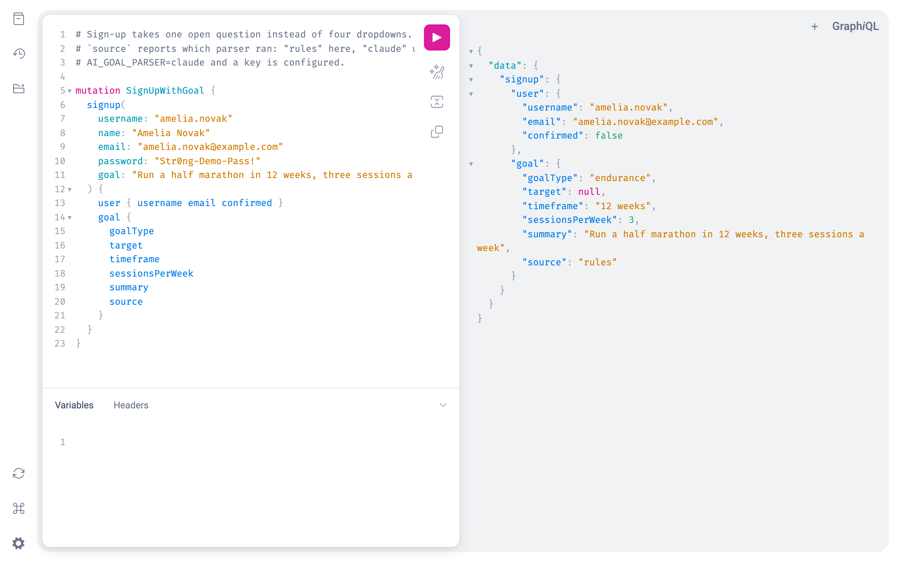

# AlterCall Fitness: identity service

A Django service that handles sign-up, email OTP confirmation and sign-in for the AlterCall coaching platform through a single GraphQL endpoint. User accounts live in AWS Cognito in production. For local work there is an in-memory provider, so you don't need an AWS account to run it.

Sign-up also accepts the member's fitness goal as free text (for example "Run a half marathon in 12 weeks, three sessions a week") and stores a structured version of it: goal type, target, timeframe and sessions per week.

## API

```
mutation signup(username, name, password, email, goal)
mutation confirmUser(username, otp)
mutation signin(username, password)
query    getUser(username) / previewGoal(text) / authProvider
GET      /healthz
```

GraphiQL is served at `/graphql`. Errors carry a stable code in `extensions.code` (for example `INVALID_CREDENTIALS`), and a wrong password and an unknown username return the same response.

Example requests and responses are in [docs/api-transcript.txt](docs/api-transcript.txt).



## Stack

Django 4.2, graphene-django, boto3 (Cognito), django-cors-headers, gunicorn.

## Local setup

```bash
python3 -m venv .venv && source .venv/bin/activate
pip install -r requirements.txt
cp .env.sample .env        # uses AUTH_PROVIDER=memory
SEED_DEMO_ON_START=1 python manage.py runserver 8000
```

Open http://localhost:8000/graphql and try:

```graphql
query { getUser(username: "rhiannon.pike") { username email goalType goalTarget } }
```

The demo seed (`python manage.py seed_demo`) creates `rhiannon.pike`, `marcus.adeyemi`, `yuki.tanaka` and `dana.oconnell`. The in-memory provider always uses `123456` as the OTP.

To run against Cognito, set `AUTH_PROVIDER=cognito` along with `COGNITO_REGION`, `COGNITO_USER_POOL_ID` and `COGNITO_CLIENT_ID`. The app client needs `USER_PASSWORD_AUTH` enabled. Goal parsing uses simple rules by default; a model-based parser can be turned on with `AI_GOAL_PARSER` and `ANTHROPIC_API_KEY` (see `.env.sample`), and it falls back to the rules on any failure.

## Testing

```bash
pip install -r requirements-dev.txt
python manage.py test
ruff check . && ruff format --check .
```

Tests don't need a `.env` or network access. The Cognito adapter is tested with `botocore.stub.Stubber`.

`docs/benchmark_signin.py` compares sign-in call counts against a local Cognito stub; output is in [docs/benchmark-output.txt](docs/benchmark-output.txt).

## Notes

- No resolver checks tokens yet, and there is no refresh, sign-out, password reset or MFA.
- Goal fields are written as Cognito custom attributes, which have to exist when the user pool is created.

